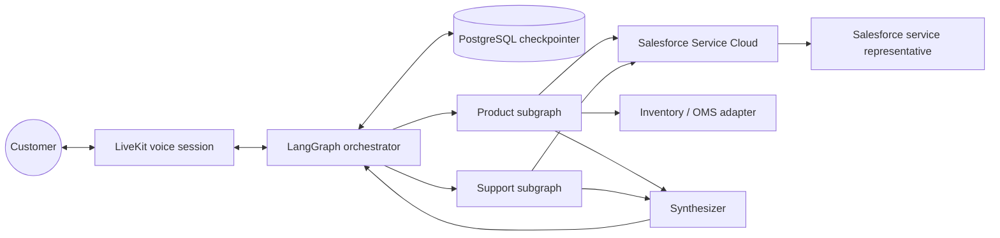

# AxiomCart Multi-Modal Voice for Salesforce

AxiomCart is a voice-first customer-service prototype that combines LiveKit,
LangGraph, PostgreSQL, and Salesforce Service Cloud. A parent graph classifies a
customer request, delegates work to product and support specialists, pauses for
missing information when necessary, and returns either a grounded response or
a human-escalation outcome.

## Initial milestone

The first milestone is a browser-based voice demonstration in which a customer
can ask a combined product and order question. The system must:

1. Transcribe the request and associate it with a stable session identifier.
2. Run the Product and Support subgraphs when both are required.
3. Query Salesforce for catalog and order data.
4. Query an inventory adapter for stock availability.
5. Pause and resume the Support subgraph when required information is missing.
6. Verify the customer before disclosing order details.
7. Synthesize a grounded response and stream it back to the customer.
8. Create or update a Salesforce Case when human assistance is required.

Actual phone-network integration and live-call transfer are deliberately outside
the first milestone. The initial demo uses a LiveKit web call and models the
handoff as a Salesforce Case and routing request.

## Architecture at a glance




## Proposed repository layout

The application structure will be created during implementation:

```text
src/axiomcart/
  api/             # Health, session, and webhook endpoints
  graph/           # Parent graph, state, routing, and synthesis
  agents/          # Product and Support subgraphs
  integrations/    # Salesforce, inventory, and LiveKit adapters
  models/          # Typed domain and tool contracts
  observability/   # Structured logging, tracing, and metrics
tests/
  unit/
  integration/
  e2e/
docs/
```

## Configuration policy

Secrets must be supplied through the runtime environment or an approved secret
manager. They must never be committed. See
[Integration contracts](docs/INTEGRATION_CONTRACTS.md) for the planned variable
names and required Salesforce permissions.

## Project status

The architecture and implementation documentation is ready, and the Salesforce
Developer Edition org has been configured with the External Client App, Orders,
integration field, and demo data. OAuth credential retrieval, the Salesforce
adapter smoke test, and application scaffolding are the next implementation
steps. No runnable application has been implemented yet.
